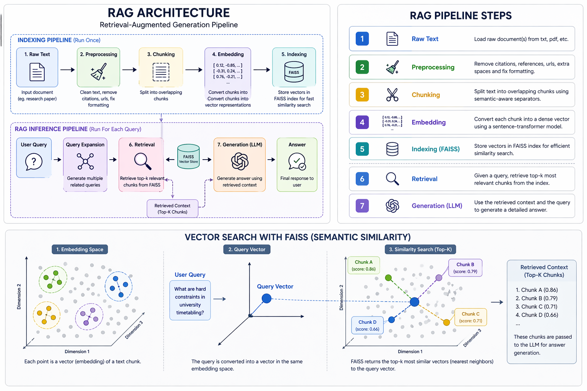
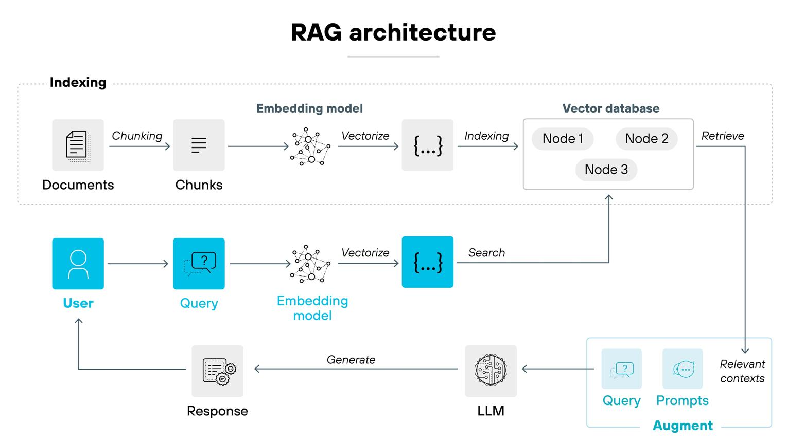
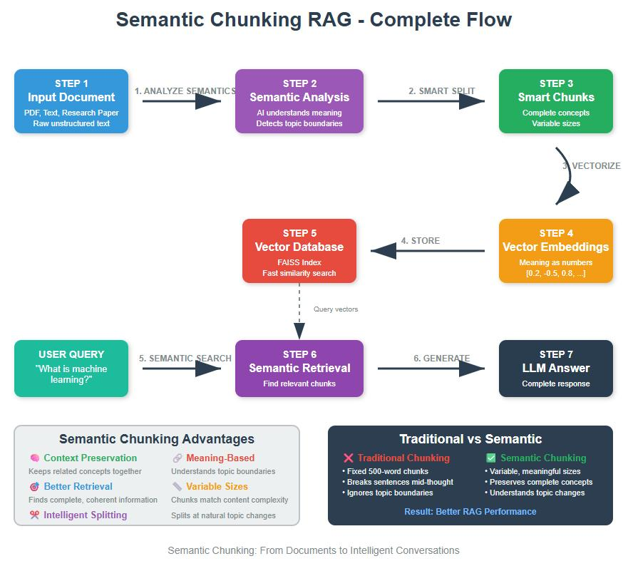
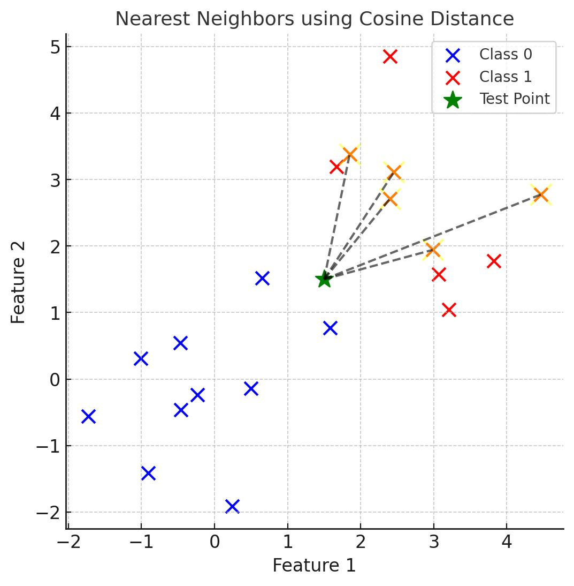

# 🤖 RAG Research Chatbot

A Retrieval-Augmented Generation (RAG) chatbot that answers questions from research documents using semantic search and LLMs.

Built as a practical implementation of a RAG pipeline, tested on a PhD thesis about Genetic Algorithms for University Course Timetabling Problems.

---

## 🧠 Overview

This project implements a complete RAG system from scratch:

1. Preprocessing — Clean raw text (remove references, citations, URLs, fix formatting)
2. Chunking — Split documents into overlapping semantic chunks
3. Embedding — Convert chunks into vector representations
4. Indexing — Store vectors in a FAISS index for fast similarity search
5. Retrieval — Find the most relevant chunks for a given query
6. Generation — Use an LLM to generate answers based on retrieved context

---
## 🧠 RAG System Overview



---

## 🧠 RAG Architecture



---

## ⚙️ Pipeline Overview



---

## 🔍 Semantic Search



---

## ✨ Features

* Text Preprocessing — Removes citations, references, URLs, and fixes formatting issues
* Smart Chunking — Uses RecursiveCharacterTextSplitter with configurable size and overlap
* Semantic Search — FAISS vector store with cosine similarity
* Multi-Query Retrieval — Expands queries for better coverage
* LLM Integration — Supports multiple models via OpenRouter
* Singleton Model Loading — Faster repeated queries
* Configurable Pipeline — All settings centralized in config.py

---

## 🛠️ Tech Stack

| Component         | Technology            |
| ----------------- | --------------------- |
| Language          | Python 3.10+          |
| Text Splitting    | LangChain             |
| Embeddings        | Sentence-Transformers |
| Vector Store      | FAISS                 |
| LLM API           | OpenRouter            |
| Config Management | python-dotenv         |

---

## 📁 Project Structure

```
rag-research-chatbot/
├── documents/
│   └── uctp.txt
├── src/
│   ├── config.py
│   ├── preprocessing.py
│   ├── chunking.py
│   ├── embeddings.py
│   ├── vector_store.py
│   ├── retrieval.py
│   ├── pipeline.py
│   ├── chatbot.py
│   └── debug.py
├── .env
├── requirements.txt
└── README.md
```

---

## 🚀 Getting Started

### Prerequisites

* Python 3.10+
* OpenRouter API key

### Installation

```bash
git clone https://github.com/YOUR_USERNAME/rag-research-chatbot.git
cd rag-research-chatbot

python -m venv venv
source venv/bin/activate
# Windows:
venv\Scripts\activate

pip install -r requirements.txt
```

### Configuration

Create a `.env` file:

```
OPENROUTER_API_KEY=your_api_key_here
MODEL_NAME=openai/gpt-3.5-turbo
```

---

## ▶️ Usage

```bash
# Build index
python -m src.pipeline

# Start chatbot
python -m src.chatbot

# Force rebuild
python -m src.pipeline --force
```

---

## 💬 Example

```
Ask: what are hard constraints in university timetabling?

Found 8 relevant chunks
Best score: 0.71

Answer:
Hard constraints are constraints that must always be satisfied...
```

---

## ⚙️ Configuration

All settings are in `src/config.py`:

* CHUNK_SIZE
* CHUNK_OVERLAP
* EMBEDDING_MODEL_NAME
* TOP_K
* SIMILARITY_THRESHOLD

---

## 📊 How It Works

### Preprocessing

* Remove citations and references
* Remove URLs
* Fix formatting

### Chunking

* Semantic splitting
* Overlapping chunks

### Retrieval

* Cosine similarity search
* Multi-query expansion

---

## 📄 Research Paper

Tested on:

Genetic Algorithms for University Course Timetabling Problems
by Sadaf Naseem Jat

---

## 📌 Future Improvements

* Add UI (Streamlit / React)
* Add reranking (Cross-Encoder)
* Add hybrid search (BM25 + Vector)
* Improve chunking with semantic boundaries

---

## 🧑‍💻 Author

Ahmed Ragab
